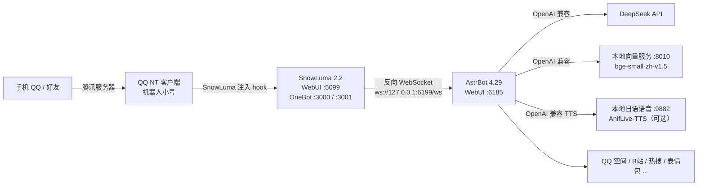

# AstrBot × SnowLuma QQ 机器人 · 可复现部署模板

> 作者：**kuris1213** ｜ 个人自托管示例，非商业用途 ｜ 部署问题先看 [docs/06-排障手册.md](docs/06-排障手册.md)

一套跑在 Windows 上的个人 QQ 机器人：**SnowLuma 把 QQ 原生会话转成 OneBot v11，AstrBot 负责对话、人格、插件与自动化**，本地挂一个中文向量模型做知识库，可选接本地日语语音。

这个仓库的目的不是「再写一个机器人」，而是把一套**已经调好的配置**完整、可复现、脱敏地交出去：别人 clone 下来，按文档装好依赖，就能跑出同样的行为。

- 部署：**[docs/01-部署指南.md](docs/01-部署指南.md)**（从零开始，含 QQ / SnowLuma / AstrBot / 模型）
- 配置：**[docs/02-配置说明.md](docs/02-配置说明.md)**（每个字段是什么意思）
- 插件：**[docs/03-插件说明.md](docs/03-插件说明.md)**（10 个插件逐项说明）
- 使用：**[docs/04-使用手册.md](docs/04-使用手册.md)**（日常怎么玩、怎么调）
- 模型：**[docs/05-模型与语音.md](docs/05-模型与语音.md)**（本地向量 + 本地日语 TTS）
- 排障：**[docs/06-排障手册.md](docs/06-排障手册.md)**（踩过的坑都在这里）

> 只支持 **Windows 10/11 x64 + PowerShell 5.1**。Linux/macOS 需要自己改脚本。
> SnowLuma、AnifLive-TTS 是第三方软件，**不随仓库分发**，需要你从官方渠道获取（原因见 [NOTICE.md](NOTICE.md)）。

---

## 架构



关键设计（改配置前务必知道）：

1. **AstrBot 是 WebSocket 服务端**，SnowLuma 是客户端；两端的 `accessToken` 必须完全一致。
2. **一个 QQ 账号 = 一个 OneBot 连接**。多开会导致重复回复。
3. **hook 必须在 QQ 登录前注入**：先起 SnowLuma，再起 QQ。反了会「能发消息、收不到消息」。
4. **会话标识 UMO** 形如 `snowluma:FriendMessage:123456789`，插件里填「会话」都用这个格式。

---

## 仓库结构

```text
.
├─ deploy\                      # 部署与运维脚本（本仓库的核心）
│  ├─ install.ps1               # 一键初始化：uv + AstrBot + 铺资源 + 渲染配置
│  ├─ start-all.ps1             # 向量 → SnowLuma → AstrBot → TTS → QQ（顺序很重要）
│  ├─ start-astrbot.ps1         # 单独启动 AstrBot（:6185 / :6199）
│  ├─ start-snowluma.ps1        # 单独启动 SnowLuma（:5099）
│  ├─ start-embedding.ps1       # 本地向量服务（:8010）
│  ├─ start-tts.ps1             # 本地日语语音（:9882，可选）
│  ├─ stop-all.ps1              # 按端口停服务，-IncludeQQ 连 QQ 一起关
│  ├─ open-admin.ps1            # 打开三个管理页
│  ├─ verify.ps1                # 部署自检（依赖 / 令牌一致性 / 文件 / 端口）
│  ├─ config.example.psd1       # 本机参数模板（install 会生成 config.psd1）
│  ├─ lib\common.ps1            # 公共函数（路径解析、端口探测…）
│  └─ tools\                    # 向量服务、配置渲染器
├─ templates\                   # 脱敏后的配置模板（占位符，无任何密钥）
│  ├─ astrbot\
│  │  ├─ cmd_config.json        # AstrBot 主配置
│  │  └─ plugins\*.json         # 10 个插件配置
│  └─ snowluma\                 # SnowLuma 的 runtime / onebot / 账号配置
├─ resources\                   # 需要铺进 AstrBot 的运行资源
│  ├─ plugins\                  # 10 个插件源码（第三方，见 THIRD_PARTY.md）
│  ├─ meme-packs\               # 两套表情包（约 120 MB，185 个文件）
│  └─ knowledge_base\           # 示例知识库（kb.db + FAISS 索引）
├─ models\
│  ├─ bge-small-zh-v1.5\        # 中文向量模型（92 MB，MIT）
│  └─ tts\                      # 语音模型占位（7 GB，需单独安装）
├─ personas\                    # 人格提示词（纯文本）
├─ assets\                      # 人格素材 / 知识库素材
├─ scripts\
│  ├─ install-tts-model.ps1     # 接入 / 校验 7 GB 语音模型
│  └─ build_templates.py        # 维护者工具：从现网配置重新生成脱敏模板
├─ docs\                        # 六篇文档
├─ NOTICE.md / THIRD_PARTY.md   # 授权与第三方清单
└─ LICENSE                      # MIT（仅原创部分）
```

**体积说明**：仓库约 280 MB，主要是 `resources/meme-packs`（120 MB）和 `models/bge-small-zh-v1.5`（92 MB）。不要这两块可以删掉，删之前看 [docs/05-模型与语音.md](docs/05-模型与语音.md)。

### 为什么仓库里没有 AstrBot / SnowLuma 的二进制

| 组件 | 处理方式 | 原因 |
|---|---|---|
| AstrBot | 不在仓库，`install.ps1` 执行 `uv tool install astrbot==4.29.3` | 它是 PyPI 包（AGPL），把整个 `site-packages` 塞进 Git 既大又无法升级；版本已锁定，装出来的行为一致 |
| SnowLuma | 不在仓库，只提供 `templates\snowluma\*.json` + 启动脚本 | 非商业授权 + 专有组件，EULA 不允许再分发；133 MB 里 90 MB 是 node.exe |
| AnifLive-TTS / 语音模型 | 不在仓库，`scripts\install-tts-model.ps1` 接入本机已有模型 | 7 GB，超过 GitHub 单文件与仓库限制；音色涉及角色版权 |
| 插件 / 表情包 / 向量模型 / 人格 / 知识库 | **在仓库** | 这些才是「调好的配置」的主体 |

语音模型单独放在夸克网盘（2.31 GiB，含 `onnx` + `voices` + `shared`）：

- 链接：<https://pan.quark.cn/s/32fa2c35348a?pwd=RF3D>
- 提取码：`RF3D`
- 文件：`kurisu-v2proplus-portable.7z`
- SHA256：`ad6f963906a737bfb24b476244476a6407ac21a67298eb0bc6003556d03467e2`

下载后接入：

```powershell
.\scripts\install-tts-model.ps1 -Source "D:\downloads\kurisu-v2proplus-portable.7z"
aniflive-tts model rebuild-engines --model-package models\tts\kurisu-v2proplus
```

> 便携包不含与本机显卡绑定的 TensorRT 引擎；重建需要 NVIDIA 显卡，详见
> [docs/05-模型与语音.md](docs/05-模型与语音.md)。大文件建议用夸克客户端下载。

---

## 快速开始

### 0. 准备

| 需要 | 说明 |
|---|---|
| Windows 10/11 x64 | PowerShell 5.1 自带 |
| 一个 QQ 小号 | 机器人账号，**不要用主号** |
| QQ NT 客户端 | 官网下载，先登录一次确认能正常用 |
| DeepSeek API Key | <https://platform.deepseek.com/>，可选；没有也能先跑起来，只是不会回话 |
| 磁盘 | 至少 5 GB（不含 7 GB 语音模型） |

### 1. 安装 SnowLuma（第三方）

从 SnowLuma 官方渠道下载 Windows x64 发行包，解压到 **仓库之外** 的目录，例如 `C:\SnowLuma`，确认目录里有 `node.exe`、`index.mjs`、`native\`。

> 为什么不能放在仓库里：SnowLuma 需要给 QQ 进程注入 hook，放在某些同步盘 / 低完整性目录里会注入失败；而且它是第三方软件，不适合进 Git 历史。

### 2. 获取仓库

```powershell
git clone https://github.com/<你的账号>/<仓库名>.git
cd <仓库名>
```

没有 Git 就下载 ZIP 解压。**路径尽量不要带中文和空格**（`startup-hidden.vbs` 对此敏感）。

### 3. 初始化

```powershell
powershell -NoProfile -ExecutionPolicy Bypass -File .\deploy\install.ps1
```

脚本会依次：

1. 安装/复用 `uv`，再装 `astrbot==4.29.3`（独立 Python 3.12，不污染系统环境）；
2. 建立 `astrbot\` 工作目录，铺开插件 / 表情包 / 知识库；
3. 询问你的**机器人 QQ**、**主人 QQ**、**DeepSeek Key**、**SnowLuma 目录**，生成随机 OneBot 令牌；
4. 把 `templates\` 渲染成 `astrbot\data\cmd_config.json`、`astrbot\data\config\*.json`、`C:\SnowLuma\config\*.json`；
5. 可选安装本地向量模型依赖（torch CPU + transformers，约 1~2 GB 下载）。

非交互式（适合脚本）：

```powershell
.\deploy\install.ps1 -Yes -BotQQ 123456789 -AdminQQ 100000001 `
  -DeepSeekKey sk-xxxx -SnowLumaHome C:\SnowLuma -SkipEmbedding
```

### 4. 启动

```powershell
powershell -NoProfile -ExecutionPolicy Bypass -File .\deploy\start-all.ps1
```

顺序是 **向量服务 → SnowLuma → AstrBot → （可选）TTS → QQ**。SnowLuma 90 秒内没起来时脚本会拒绝启动 QQ，避免 hook 注入顺序错误。

### 5. 登录与验证

| 服务 | 地址 | 账号 |
|---|---|---|
| AstrBot 面板 | <http://127.0.0.1:6185> | `astrbot` + **首次启动日志里的 Initial password** |
| SnowLuma 面板 | <http://127.0.0.1:5099> | `admin` + install 最后打印的初始密码 |
| 主动消息管理端 | <http://127.0.0.1:4100> | 无 |

AstrBot 初始密码在 `logs\astrbot.out.log` 里：

```powershell
Select-String -Path .\logs\astrbot.out.log -Pattern 'Initial password'
```

登录后第一件事：**改密码**。然后用另一个 QQ 私聊机器人账号，发一句 `/help` 或「在吗」测试。

运行自检：

```powershell
.\deploy\verify.ps1
```

---

## API Key 与费用（部署前必读）

**这个仓库不包含任何可用的 DeepSeek API Key，作者也不会提供共享 Key。**

- 对话能力由 AstrBot 调用 DeepSeek 云端 API 提供，API 按账号计费，所以**每一个部署者都要用自己注册的 Key**。
- Key 只写在你本机的两个文件里：`deploy\config.psd1`、`astrbot\data\cmd_config.json`。两者都在 `.gitignore` 中，不会进入 Git。
- 装完后 `install.ps1` 会把同样的提醒写到 `logs\API-KEY-README.txt`；`start-astrbot.ps1` 发现没配 Key 时也会在控制台告警。
- 没有 Key 时：机器人能启动、能收到 QQ 消息，但**不会回复对话**；热搜、梗百科等命令类插件仍可用。
- 不要把 Key 发给别人、贴到 Issue/截图里，或用 `git add -f` 提交。
- 获取：<https://platform.deepseek.com/api_keys>。换用其他云模型或本地 Ollama，见 [docs/02-配置说明.md](docs/02-配置说明.md#32-必须关注的字段)。

> 一句话：**Key 是部署者自己的账号凭据，费用也记在部署者自己的账户；别人 clone 你的仓库后，要填他自己的 Key。**

---

## 端口一览

| 端口 | 服务 | 用途 |
|---|---|---|
| 3000 | SnowLuma | OneBot v11 HTTP API |
| 3001 | SnowLuma | OneBot v11 正向 WebSocket |
| 4100 | AstrBot · proactive_chat | 主动消息独立管理端 |
| 5099 | SnowLuma | WebUI |
| 6185 | AstrBot | Dashboard |
| 6199 | AstrBot | OneBot 反向 WS（SnowLuma 连入） |
| 8010 | 本地向量服务 | OpenAI 兼容 `/v1/embeddings` |
| 9882 | AnifLive-TTS | 本地语音合成（可选） |
| 18999 | qzone_ultra | QQ 空间守护进程 |

全部只监听 `127.0.0.1`，局域网/公网访问不到。

---

## 隐私与安全

- 仓库里**没有任何**真实 QQ 号、API Key、Cookie、面板密码、聊天记录；配置全是占位符。
- `deploy\config.psd1`、`astrbot\data\`、`logs\`、`models\tts\` 都在 `.gitignore` 里。**不要**用 `git add -f` 把它们加进去。
- 提交前自检：

  ```powershell
  git status --short
  git grep -nE "sk-[A-Za-z0-9]{20,}|SESSDATA|BILI_JCT|REFRESH_TOKEN|pbkdf2_sha256"
  ```

- 面板、OneBot、SnowLuma 全部只绑回环；不要把 6185 / 5099 暴露到公网。
- `.env` 式的密钥管理：本仓库用 `deploy\config.psd1`（本机文件），它只存在于你的机器上。

更多见 [docs/07-安全与脱敏.md](docs/07-安全与脱敏.md)。

---

## 常见问题（完整版见 docs/06）

| 现象 | 处理 |
|---|---|
| 机器人能发不能收 | hook 注入顺序错了：停 SnowLuma → 重启 QQ → 再起 SnowLuma |
| AstrBot 面板登录不了 | 看 `logs\astrbot.out.log` 里的 Initial password；改过密码就用你自己设的 |
| 发语音没反应 | `:9882` 没起，或 `config.psd1` 里 `TtsEnabled = $false` |
| 知识库检索报错 | `:8010` 没起，或 `.venv-embedding` 缺 torch/transformers |
| 主动消息不发 | 电脑睡眠导致定时任务错过；见 docs/06 第 2 节 |
| 脚本报「字符串缺少终止符」 | `.ps1` 丢了 UTF-8 BOM（PowerShell 5.1 会按 GBK 解析中文） |

---

## 发布到 GitHub

仓库已经 `git init` 并做好首个提交（作者是占位身份）。发布前先把作者改成你自己：

```powershell
git config user.name  "你的名字"
git config user.email "you@example.com"
git commit --amend --reset-author --no-edit
```

然后在 GitHub 新建一个**空仓库**（不要勾选 README / .gitignore），再：

```powershell
git remote add origin https://github.com/<你的账号>/<仓库名>.git
git branch -M main
git push -u origin main
```

注意事项：

- `model.safetensors` 是 91.4 MB，GitHub 单文件上限 100 MB，能推但会提示「文件较大」。想更轻就把 `models/` 从历史里拿掉，让使用者自己下（见 docs/05）。
- 不要用 `git add -f` 强推 `deploy/config.psd1`、`astrbot/data/`、`logs/`。
- 推之前再跑一遍：

  ```powershell
  git status --short
  git grep -nE "sk-[A-Za-z0-9]{20,}|SESSDATA|BILI_JCT|pbkdf2_sha256"
  ```

- 建议在仓库 Settings → Code security 里打开 **Secret scanning** 和 **Push protection**。

---

## 授权

- 原创部分（脚本 / 文档 / 模板）：**MIT**，见 [LICENSE](LICENSE)。
- 插件、表情包、人格、模型：各自授权，见 [NOTICE.md](NOTICE.md) 与 [THIRD_PARTY.md](THIRD_PARTY.md)。
- 本项目与腾讯、B 站、《命运石之门》权利方均无关联。使用非官方协议端有账号风险，请自行评估。
